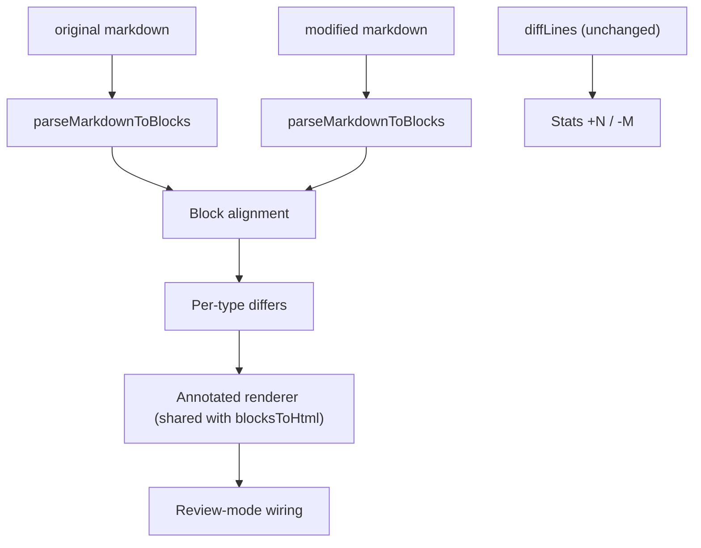

# AI Diff Rendering Strategy

How the Formatted view should render AI edits — especially edits that touch
**interactive components** (tables, task lists, code blocks, Mermaid diagrams,
blockquotes, links) — so that the review looks exactly like the document the
user will get, while making every change visible and unambiguous.

Target behaviour is pinned down by
[`test/diffRendering.test.ts`](../test/diffRendering.test.ts).

---

## 1. Current state and why it breaks

`formatMarkdownDiff()` in [`src/markdown/diffEngine.ts`](../src/markdown/diffEngine.ts)
runs a **line-level LCS** over the raw markdown and then guesses, line by line,
what each line "looks like" (list item, heading, table row, fence…). It has its
own mini-renderer that is independent of the real editor renderer
(`parseMarkdownToBlocks()` + `blocksToHtml()` in
[`src/markdown/parser.ts`](../src/markdown/parser.ts)).

This produces four classes of defects:

| # | Root cause | Symptoms |
|---|---|---|
| A | **Only adjacent `del`+`add` pairs are matched.** The LCS emits change runs as `del,del,add,add`. | Multi-line edits render as "deleted / garbage-modified / added" in paragraphs, table rows and code lines. |
| B | **Fence state is toggled on any line, regardless of side.** A removed ` ```js ` and an added ` ```ts ` toggle twice. | Changing a code-block language empties the block, renders code as prose and swallows the rest of the document into a code block. |
| C | **Second, divergent renderer.** Block types are guessed per line; quotes, `hr`, nested/ordered lists and soft-wrapped paragraphs are unknown; `escapeHtml` is used instead of `parseInlineMarkdown`. | `> quote` and `**bold**` shown literally, every ordered item is "1.", nested lists flattened, `---` rendered as text. |
| D | **Inline diff operates on raw markdown characters.** | `**old**` → `**new**` shows as `**~~old~~new**`; checkbox toggles and link-URL changes are invisible; changed table checkbox cells show `[ ]` text. |

Structural table edits (column added, header replaced) additionally leak the
delimiter row (`|---|`) into the body as a data row.

---

## 2. Principles

1. **One parser, one renderer.** The diff never re-detects markdown syntax. Both
   sides are parsed with `parseMarkdownToBlocks()`; HTML is produced with the
   same per-block renderers as `blocksToHtml()`. The review must look like the
   final document — same components, same classes, same layout.
2. **Diff is a decoration layer, not a separate rendering.** The renderer emits
   the *modified* (after) document and attaches diff annotations
   (classes, `data-diff-*` attributes, `<ins>`/`<del>`). Removed content appears
   as "ghost" elements in the position it used to occupy.
3. **Diff at the granularity of the component.** Blocks are aligned first, then
   each block type has its own differ that understands its structure
   (list items, table rows/columns, code lines, diagram source).
4. **Every semantic change must be visible.** If a change alters what the user
   sees or what a component does (a checkbox state, a link target, a code
   language, a column alignment) it gets an explicit marker, even when the
   visible text is identical.
5. **Interactive components are inert during review — but still useful.**
   Anything that mutates the document is disabled; anything read-only
   (copy code, pan/zoom a diagram, toggle diagram/code view, open link) keeps
   working.
6. **Fail soft, per block.** If a block-level differ cannot produce a coherent
   result, that single block falls back to a *source diff* (line diff of its
   markdown in a code-diff frame). One bad block never corrupts its neighbours.

---

## 3. Pipeline



### 3.1 Parse

- Both documents go through `parseMarkdownToBlocks()`. Every block keeps
  `startLine/endLine`, so its **source slice** is available for fallbacks and
  for raw-mode cross-linking.
- Fence detection must live in **one shared helper** used by both the parser and
  any diff code (see §5.5). Diffs must never know about syntax the editor
  doesn't render, and vice versa.

### 3.2 Block alignment

1. Compute a **signature** per block: `type + normalised content`
   (for lists/tables the full serialised block; for code `language + content`).
2. Run LCS on the signature arrays → exact matches become `unchanged`.
3. For each run of unmatched blocks between two anchors
   (`removed[]` vs `added[]`), pair blocks greedily by
   **(same type) ∧ similarity ≥ 0.5**, where similarity is token-level Dice
   coefficient over the block text. Order is preserved (no crossing pairs).
   - Paired → `modified` (handed to the type differ).
   - Unpaired removed → `removed` ghost block.
   - Unpaired added → `added` block.
4. **Type changes** (paragraph → list, code → paragraph, table → table with a
   different column set that fails pairing) are rendered as `removed` +
   `added`, never forced through an inline diff.
5. Empty-line paragraphs are alignment-neutral: they are never marked and never
   paired.

This step fixes defect A at block level and defect B entirely (fences are
already resolved inside each parsed block).

### 3.3 Run pairing at line/row/item level

Wherever a sequence differ is used *inside* a block (code lines, table rows,
list items, quote lines), use the same rule as block alignment:
**collect the whole `del` run and the whole `add` run between two `same`
anchors, then pair by similarity in order**. Never pair "the next line only".
Implement once as `pairChangeRuns(diffs, similarity, threshold)` and reuse it
(also fixes `formatRawDiff` and `formatCodeBlockDiff`).

### 3.4 Render

`blocksToHtml()` is refactored so each block type is a function
`renderX(block, ctx)` where `ctx` optionally carries the diff annotation for
that block. Normal editing calls it without annotations; the diff calls it
with them. This guarantees identical markup and gets new block features into
the review "for free".

### 3.5 Wire

`displayAiDiff()` wires only the review-safe interactions (§6). It must not
call the editing wiring (`wireTableInteractions`, `wireTaskCheckboxes`).

### 3.6 Stats

Toolbar `+N / −M` stays line-based (`countDiffStats(diffLines())`); it matches
what Git and the raw view report.

---

## 4. Inline diff (paragraphs, headings, quote lines, list items, table cells)

Goal: diff the *visible text*, render the *real formatting*, keep HTML well-formed.

1. **Markdown-aware tokenisation.** Tokenise with atoms that never split:
   - formatting delimiters (`**`, `__`, `*`, `_`, `~~`, `` ` ``) as single tokens,
   - an entire link `[label](url "title")` as one composite token whose
     *display* is the label and whose *identity* includes the URL,
   - inline code spans as one token,
   - words, whitespace and punctuation as today.
2. **Diff tokens** with LCS (word level).
3. **Sentinel merge.** Build one merged markdown string from the token diff,
   wrapping changed spans in private-use sentinels
   (`\uE000…\uE001` = insertion, `\uE002…\uE003` = deletion). Then run
   `parseInlineMarkdown()` on the merged string and finally replace sentinels
   with `<ins class="diff-ins">` / `<del class="diff-del">`.
4. **Keep it well-formed.** Before parsing, split any sentinel span that
   crosses a formatting delimiter so that `ins`/`del` are always nested *inside*
   the formatting element (`<strong><del>old</del><ins>new</ins></strong>`),
   never interleaved with it.
5. **Formatting-only changes** (`word` → `**word**`, `*a*` → `a`): the text is
   unchanged, so render the *new* formatting and mark the affected element with
   `class="diff-format-changed"` (dotted blue underline; `title` explains
   "Formatting changed"). Never show raw delimiters.
6. **Link changes:**
   - label changed → normal inline diff inside the `<a>`;
   - URL/title changed with the same label → `a.diff-link-changed` plus
     `data-diff-old-href="…"` (tooltip shows old → new target).

---

## 5. Component strategies

### 5.1 Paragraphs & headings

- One block = one element (soft-wrapped lines are already joined by the parser).
- Heading **level** change → render new level, add `data-diff-old-level` and a
  small `H2 → H3` badge; text diff as usual.

### 5.2 Blockquotes

- Render via the normal blockquote renderer: one `<blockquote>` with one `<p>`
  per line — never a paragraph with a literal `>`.
- Inside a modified quote, run-pair lines (§3.3) and inline-diff each pair.
- Whole quote added/removed → block marker on the quote container.

### 5.3 Lists (bullet, ordered, task)

- Align **items** within a list (LCS on item text, then run pairing). Items get
  `diff-item-added | diff-item-removed | diff-item-modified`.
- Nested children recurse with the same algorithm; nesting is preserved
  because items are rendered by the shared list renderer.
- Ordered lists render as **one `<ol>`** with the original `start`; removed
  ghost items are excluded from numbering (`value` attribute on items) so
  numbers match the final document.
- **Task checkbox toggled** (`[ ]` ↔ `[x]`) is a first-class change: the
  checkbox renders in its *new* state, the `<li>` gets `diff-checkbox-changed`
  and `data-diff-old-checked`. A subtle pulse ring around the checkbox makes it
  findable. Text changes in the same item are diffed independently.
- Changing the list *type* (bullet ↔ ordered ↔ task) is shown on the list
  container (`data-diff-old-type`), items keep their own diffs.

### 5.4 Tables

Tables are diffed as a **grid**, not as lines.

1. **Columns.** Align the header cells (LCS on normalised header text).
   - Unmatched new header → column `diff-col-added` (applied to the `th` and
     every `td` in that column).
   - Unmatched old header → ghost column `diff-col-removed`, rendered in its
     old position with struck-through content.
   - Matched header with changed text → inline diff in the `th`.
   - Alignment change (`:--` → `--:`) → `th` gets `data-diff-old-align`.
   The delimiter row is **never** rendered as content.
2. **Rows.** Align body rows by LCS on full-row text, then run pairing by
   similarity (prefer a stable key: first column text if unique).
   Rows get `diff-row-added | diff-row-deleted | diff-row-modified`.
3. **Cells.** For paired rows, compare cells **through the column mapping**
   (not by index), so inserting a column does not mark every cell to its
   right as changed. Changed cells get `diff-cell-modified` with an inline diff
   (§4), so formatting renders.
4. **Checkbox cells** stay checkboxes: rendered in the new state with
   `diff-checkbox-changed`; never shown as `[ ]` text.
5. **Unpairable structure** (completely different header set): render the old
   table as a `removed` block and the new table as an `added` block.
6. Escaped pipes (`\|`) are handled by `parseTableRow()` only — no other split.

### 5.5 Code blocks

1. **Fences.** A single helper `matchFence(line)` returns
   `{ char: '`' | '~', length, info }`; a block closes only on a fence of the
   same char with length ≥ the opener. Used by the parser *and* the diff.
   (Today the parser itself only knows ```` ``` ```` and breaks on four-backtick
   fences; that is a parser fix, and the diff inherits it automatically.)
2. **Unchanged block** → rendered exactly like the editor (normal header,
   copy button, language label) — no "AI Diff" badge, no diff frame.
3. **Modified block** → `code-diff-wrapper` frame with gutter `+ / −`, lines
   aligned with run pairing (§3.3) and intra-line token highlights.
   - Language change → header shows `js → ts` (`data-language` = new,
     `data-diff-old-language` = old); content lines that didn't change stay
     `same`.
4. **Added / removed block** → normal code rendering with the block marker
   (green/red edge); no per-line `+`/`−` noise.
5. **Copy button** in review copies the **new** code (`data-copy-source`),
   never gutters or deleted lines. Removed blocks copy the old code.
6. Very large blocks (> 400 changed lines) collapse unchanged stretches to
   "⋯ 37 unchanged lines" separators, expandable on click.

### 5.6 Mermaid diagrams

Mermaid blocks are the most interactive component (diagram view, code toggle,
pan/zoom). In review:

- Render as a normal `is-mermaid-block` showing the **new diagram** by default,
  marked `diff-block-modified`, with a segmented control in the header:
  **After · Before · Code diff**.
  - *After/Before* render with `renderMermaidPreviewHtml()` on each side.
  - *Code diff* shows the §5.5 line diff of the source.
- Pan/zoom and view toggle remain enabled (read-only).
- If either side fails to render, default to *Code diff* and show the render
  error inline.
- **Stretch goal:** because diagrams are rendered by our own
  [`src/mermaid`](../src/mermaid) parsers, nodes/edges can be diffed on the
  parsed model and highlighted directly in the SVG (`.diff-node-added`,
  `.diff-node-removed` ghost, `.diff-edge-changed`).

### 5.7 Horizontal rules & other leaf blocks

- `hr` renders as `<hr>` with the normal widget wrapper.
- Added/removed `hr` → block marker only.

---

## 6. Review-mode interaction contract

| Component | Allowed in review | Blocked in review |
|---|---|---|
| Text blocks | select, copy | editing (`contenteditable=false` on canvas) |
| Links | open (same gesture as edit mode) | editing |
| Task lists | — (checkbox shows new state) | toggling (`disabled`), drag, delete, add |
| Tables | horizontal scroll, select/copy | cell editing, row/col controls, checkbox toggle |
| Code blocks | copy (new code), horizontal scroll | editing code, editing language input (`readonly`) |
| Mermaid | view toggle, pan/zoom, Before/After/Code diff | editing source |
| All widgets | — | delete button, drag handles |

Implementation: the canvas carries `is-review-mode`; renderers emit
`disabled` / `readonly` / `contenteditable="false"` when `ctx.review` is set;
CSS hides mutating controls (already partly in `diff.css`).

---

## 7. DOM contract (what tests assert)

| Element | Marker |
|---|---|
| Changed block (top-level element or its widget container) | `diff-block-added` / `diff-block-removed` / `diff-block-modified` |
| Inline text | `ins.diff-ins`, `del.diff-del` |
| Formatting-only change | `.diff-format-changed` |
| Link target change | `a.diff-link-changed[data-diff-old-href]` |
| List item | `diff-item-added` / `diff-item-removed` / `diff-item-modified` |
| Checkbox state change (task item or table cell) | `.diff-checkbox-changed[data-diff-old-checked]` |
| Table row | `diff-row-added` / `diff-row-deleted` / `diff-row-modified` |
| Table column | `diff-col-added` / `diff-col-removed` on `th` and `td` |
| Table cell | `diff-cell-modified` |
| Modified code block | `.code-diff-wrapper`, lines `.code-diff-add/.code-diff-del/.code-diff-same` |
| Code language change | `[data-diff-old-language]` on the wrapper |
| Unchanged code block | normal editor markup, **no** `.code-diff-wrapper` |
| Mermaid change | `.is-mermaid-block.diff-block-modified` with views `after` / `before` / `code-diff` |

Unchanged blocks carry **no** diff markers.

---

## 8. Raw mode

Raw mode stays a line diff (it *is* the source view), but adopts run pairing
(§3.3) so intra-line highlights pair the right lines.

---

## 9. Implementation phases

1. **Foundations** — `pairChangeRuns()`; shared `matchFence()`; refactor
   `blocksToHtml()` into per-type renderers with an optional diff context.
2. **Block alignment** — signatures, LCS, similarity pairing; paragraphs,
   headings, quotes, `hr` through the shared renderer.
3. **Inline diff** — markdown-aware tokens, sentinel merge, format/link change
   markers.
4. **Lists** — item alignment, nesting, ordered numbering, checkbox changes.
5. **Tables** — column mapping, row pairing, checkbox cells, structural
   fallback.
6. **Code & Mermaid** — unchanged passthrough, language change, copy source,
   Before/After/Code-diff toggle.
7. **Review-mode contract** — `ctx.review` attributes, wiring audit, CSS.

Each phase un-skips its group in `test/diffRendering.test.ts`.

---

## 10. Testing

- `test/diffRendering.test.ts` renders `formatMarkdownDiff()` output into
  JSDOM and asserts the DOM contract (§7). Tests that describe not-yet-built
  behaviour are registered with `target(...)` and skipped by default; run them
  with:

  ```bash
  DIFF_STRATEGY_TESTS=1 npx mocha -r tsx test/diffRendering.test.ts
  ```

- Regression guards (behaviour that already works and must keep working) use
  plain `it(...)` and always run.
- When a phase lands, switch its tests from `target` to `it`.
